# Project 3: Role-Based Access Control (R-B-A-C)

# The Purpose of This Lab

To demonstrate the importance of Role-Based Access Control (RBAC) in an organization by ensuring users only have access to the resources required for their roles.

### Business Context

Organizations have an important responsibility when managing employee access to resources. Ensuring employees have the appropriate access is crucial to preventing unauthorized access to sensitive information. Implementing RBAC through Active Directory simplifies access management while supporting the principle of least privilege. This reduces the need to assign permissions to individual users, as access can be managed through security group membership and inherited permissions

### Lab Environment

* VMware Workstation
* Windows Server 2025 Domain Controller
* One Windows 11 domain-joined client VM
* DNS integrated with Active Directory
* lab.local Active Directory domain
* Departmental OUs (IT, HR, & Sales)
* Active Directory Users and Computers (ADUC)
* Departmental shared folders (IT, HR & Sales)
* Global and Domain Local Security Groups
* NTFS permissions

### OU Structure

Lab.local is organized into the following departments:

* IT
* HR
* Sales

### Existing Active Directory Environment

* The OU Structure involves three departments - IT, HR & Sales.

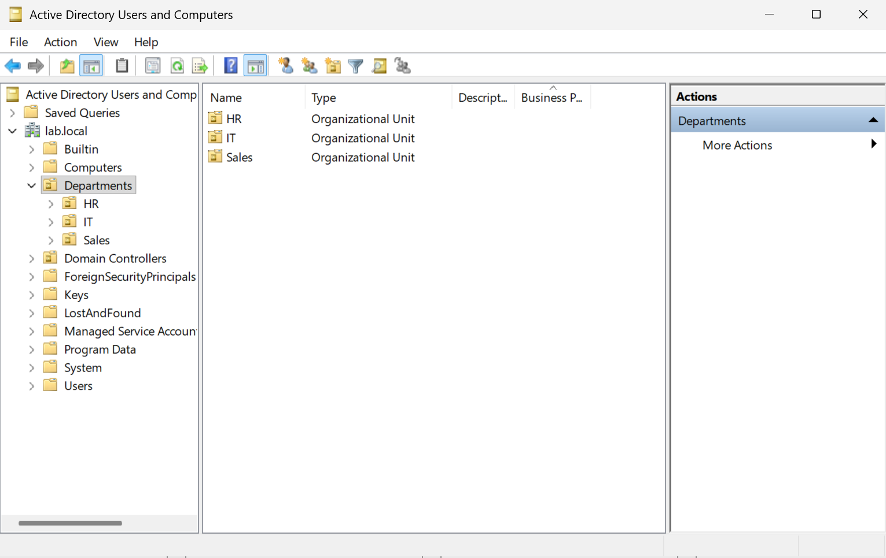

* Users are placed in their designated OU reflected on the department they are employed in.

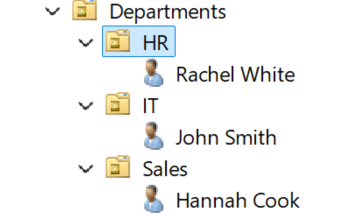

### Security Group Creation & AGDLP

* Creation of Global Security and Domain Local Security Groups.
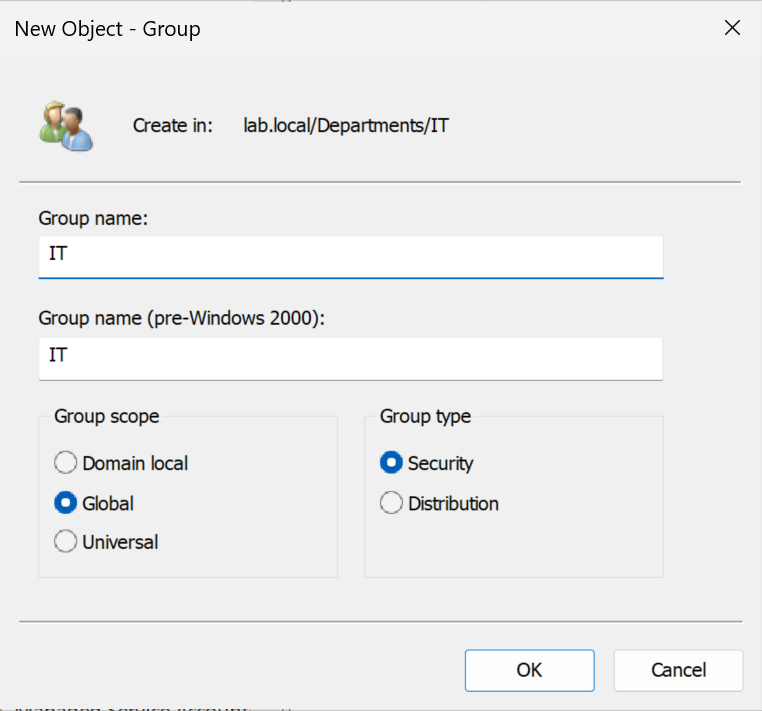

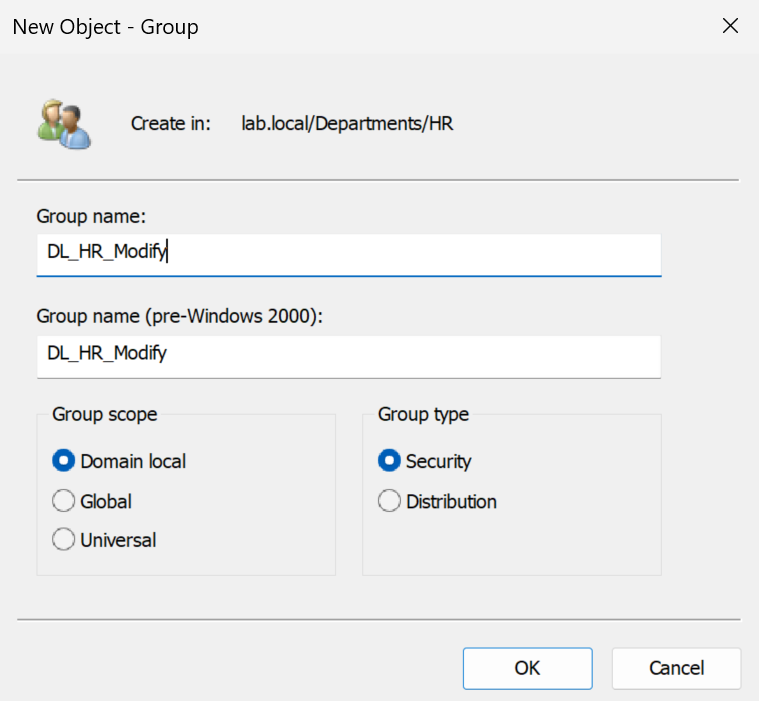

A Global Security Group organizes the user based on their department, while a Domain Local Group determines the access to specific resources based on assigned permissions. 

* Account, Global, Domain, Local, Permission is utilized and recommended by Microsoft for implementing RBAC in Active Directory.

**Let's verify an IT user has the correct IT Groups he can access.**

* John is shown below in an IT **"Security Group"** and **"Global Security Group".**

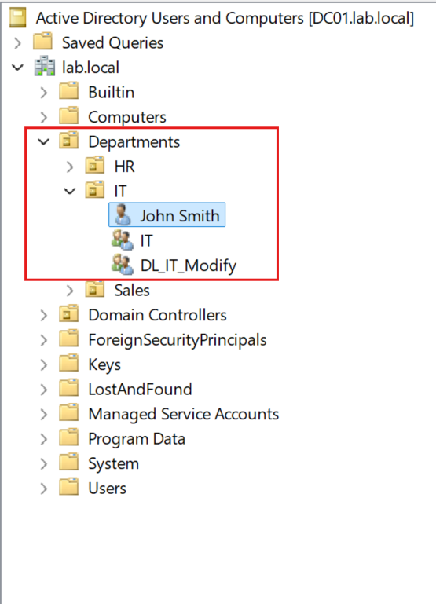

### Shared Folders & Permissions

* IT, HR, and Sales shared folders are created on the Domain Controller's C:\ drive and will later be configured with the appropriate access permissions.

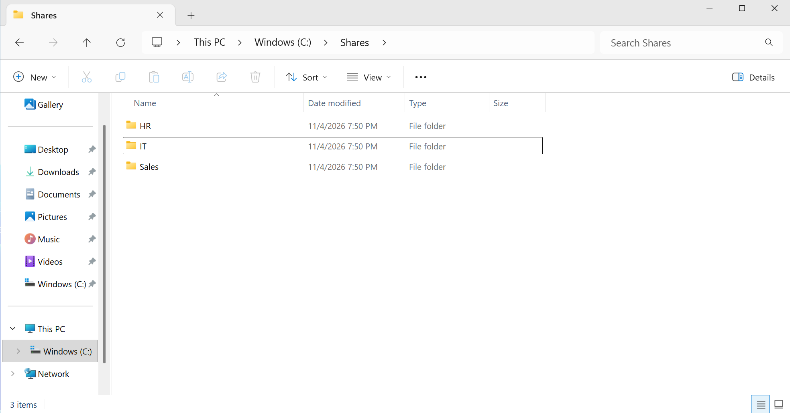

* We can now set up the permissions for the IT shared folder.
  * Locate the **Sharing Tab** then select **Advanced Sharing** and click the box **Share this folder.**
  * Then click **Permissions**.
  * **MAKE SURE TO CLICK APPLY EACH TIME YOU MAKE A CHANGE!**
* **Authenticated Users** can ONLY Change and Read this folder, while **Administrators** will have Full Control.

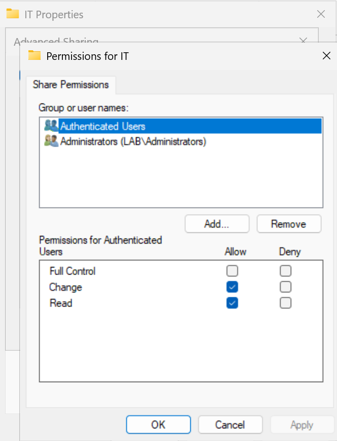

* Now we will dive deeper into the Security attributes of this folder.
    * Click the tab to the right labeled **Security**.
    * Then navigate to **Edit.**
    * From here you will want to **Add** the Domain Local Security Group.
    * In this example we would type **DL_IT_Modify** then select check name. It will underline then you can press ok.
    * The next screen you are brought to will show you groups and users that are shared this folder.

NTFS Permissions in an organization are essential for controlling who can access, read, modify or manage the files/folders.

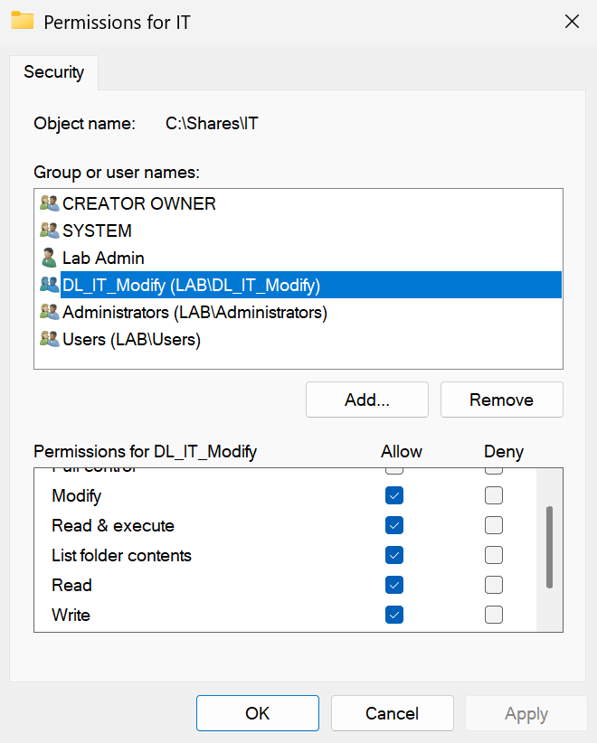

### Access Testing & Verification

* On the Domain Controller let's create a txt doc on the local drive (C:\)

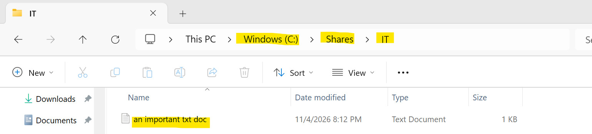 

* We will have to map the drive on the IT user's PC.
* Head over to **File Explorer** and right-click **This PC**
* Select **Map network drive** and enter the information show similar to the example.
  * Note: You will be typing in the server and the shared folder you want to allow the user access to.
* Click **Finish** and it should connect.
  * You can choose whether to enable **Reconnect at sign-in** based on your preference. If unchecked, you will need to manually remap the network drive each time you sign in.

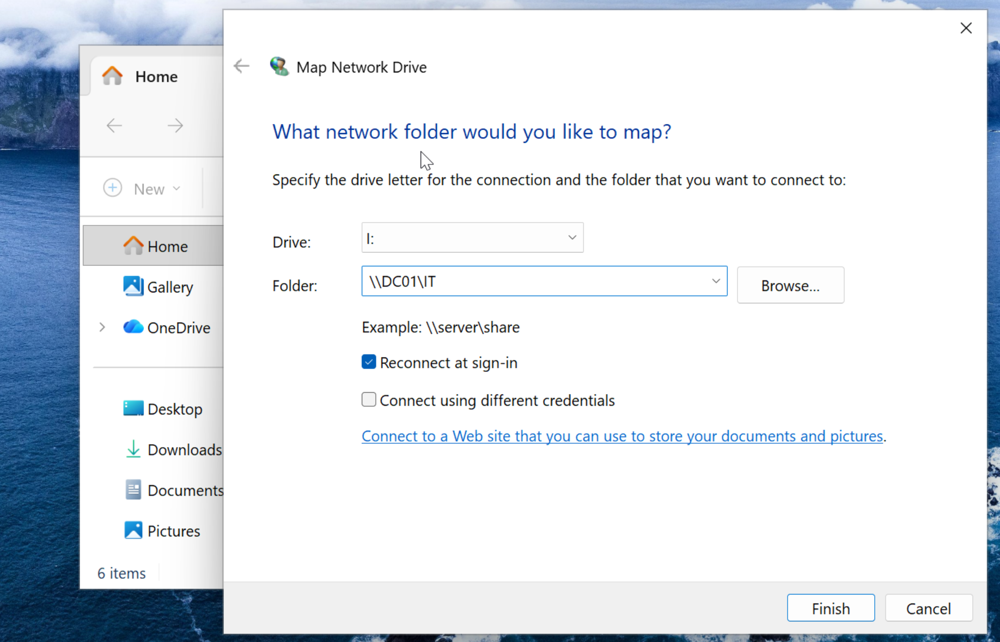

* We have a file already in that shared folder that was created. How about we modify it from the IT user's PC?

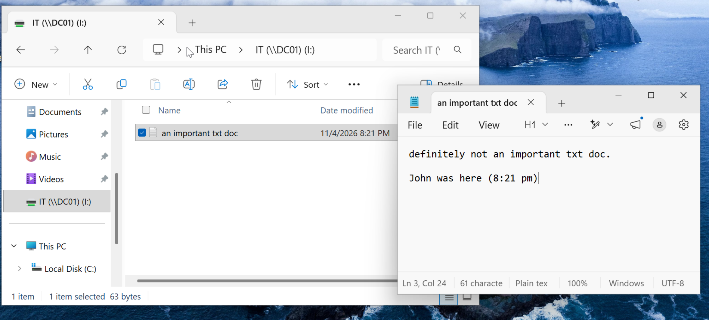

* **MAKE SURE TO SAVE OR THE CHANGES WON'T TAKE AFFECT!**

Let's verify the change was made on the Domain Controller.

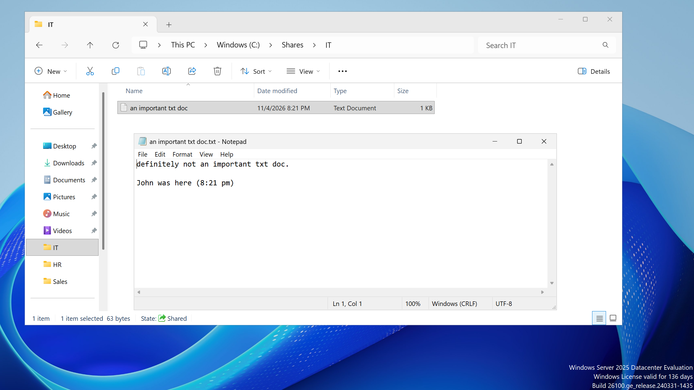

* An IT user would not have access to an HR Folder shown below.
* As you can see the Domain Local Security Group (DL_HR_Modify) verifies only HR users and Admin would have access to that folder.

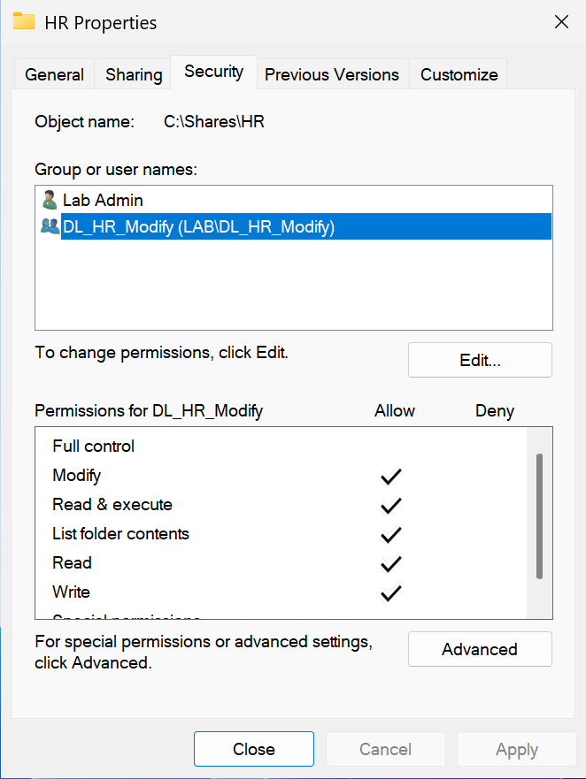

* Now if a user doesn't have access to the folder they would be prompted by a **Denied Access** window which would require contacting their administrator(s).
* For example, an IT User would NOT have access to the HR or Sales Drive.
 * Trying to map the drive and searching the drive using run command (Windows Key + R) would result in the same denied access prompt.

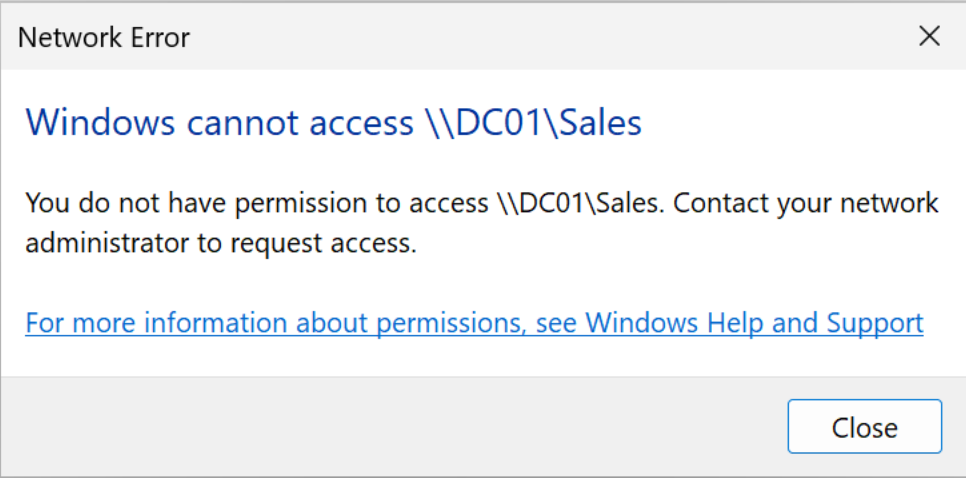
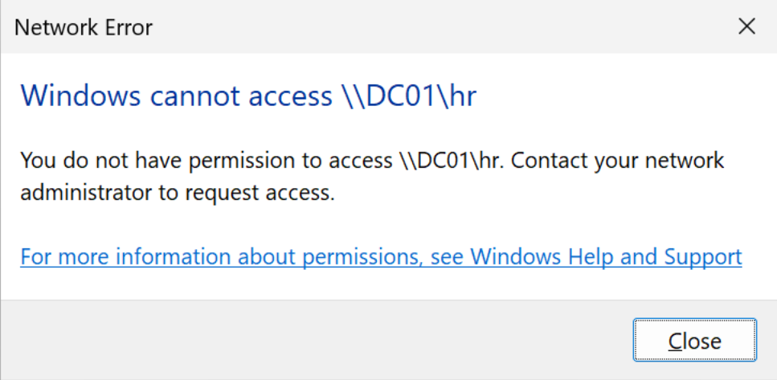

## Properly implemented RBAC simplifies access management, enforces the principle of least privilege, and reduces unauthorized access to protect an organization's sensitive resources.
 

