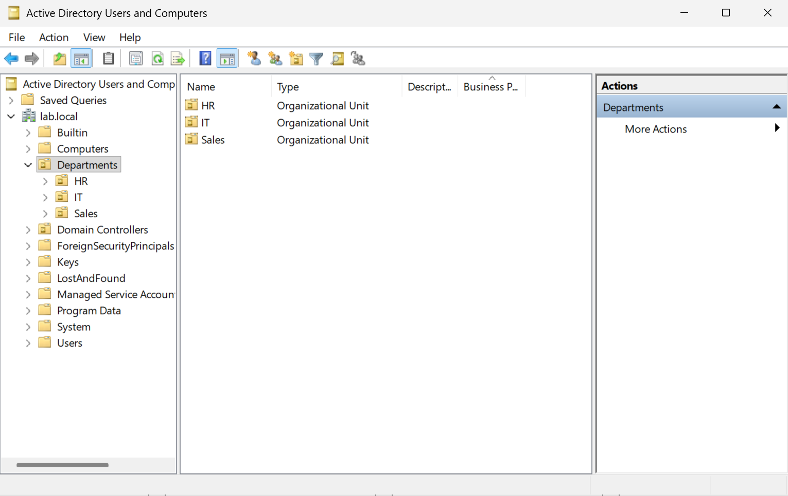
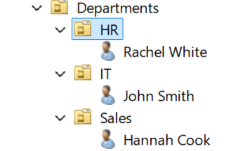

# Project 3: Role-Based Access Control (R-B-A-C)

# The Purpose of This Lab

To demonstrate the importance of Role-Based Access Control (RBAC) in an organization by ensuring users only have access to the resources required for their roles.

### Business Context

Organizations have an important responsibility when managing employee access to resources. Ensuring employees have the appropriate access is crucial to preventing unauthorized access to sensitive information. Implementing RBAC through Active Directory simplifies access management while supporting the principle of least privilege. This reduces the need to assign permissions to individual users, as access can be managed through security group membership and inherited permissions

### Lab Environment

* VMware Workstation
* Windows Server 2025 Domain Controller
* One Windows 11 domain-joined client VM
* DNS integrated with Active Directory
* lab.local Active Directory domain
* Departmental OUs (IT, HR, & Sales)
* Active Directory Users and Computers (ADUC)
* Departmental shared folders (IT, HR & Sales)
* Global and Domain Local Security Groups
* NTFS permissions

### OU Structure

Lab.local is organized into the following departments:

* IT
* HR
* Sales

### Existing Active Directory Environment

* The OU Structure involves three departments - IT, HR & Sales.

* Users are placed in their designated OU reflected on the department they are empoloyed in.

